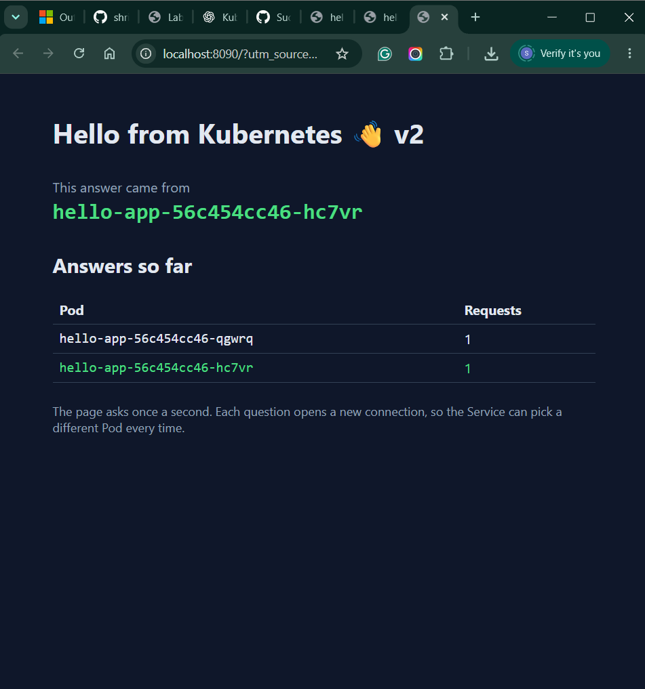

# Lab 3 — hello-app on Kubernetes with Terraform

**Name:** Suchit  
**Roll Number:** 261100680008

---

## Part 1: First `terraform plan`

**Command:**

```powershell
terraform plan
```

**Output:**

```text
Plan: 2 to add, 0 to change, 0 to destroy.

Changes to Outputs:
  + url = "http://localhost:8080"
```

The plan showed that Terraform would create two Kubernetes resources and output the application URL.

### Part 1: `terraform output -raw url`

**Command:**

```powershell
terraform output -raw url
```

**Output:**

```text
http://localhost:8080
```

The application was accessible at `http://localhost:8080`.

---

## Part 2: Plan for the v1 → v2 image change

Changed the container image tag from `v1` to `v2` in the Terraform configuration.

**Relevant plan output:**

```text
~ image = "shripada/hello-app:v1" -> "shripada/hello-app:v2"

Plan: 0 to add, 1 to change, 0 to destroy.
```

Terraform detected that the Deployment needed an in-place update to use the new image version.

---

## Part 3: Terraform drift detection

Manually scaled the Kubernetes Deployment from 3 replicas to 5 using:

```powershell
kubectl scale deployment hello-app --replicas=5
```

Then ran `terraform plan` to detect the difference between the actual Kubernetes configuration and the desired configuration.

**Relevant plan output:**

```text
~ replicas = "5" -> "3"

Plan: 0 to add, 1 to change, 0 to destroy.
```

Terraform detected the drift and planned to restore the replica count to 3.

After running `terraform apply`, the Deployment was restored to the desired configuration.

---

## Part 4: Reusable module with dev and prod environments

Created a reusable `hello-app` Terraform module and used it in two separate environments.

**Dev environment:**
- Namespace: `dev`
- Image tag: `v2`
- Replicas: `3`
- Service port: `8080`

**Prod environment:**
- Namespace: `prod`
- Image tag: `v2`
- Replicas: `3`
- Service port: `8090`

Each environment uses its own Terraform configuration and state file.

**Command:**

```powershell
kubectl get svc -A
```

**Output:**

```text
NAMESPACE     NAME         TYPE           CLUSTER-IP      EXTERNAL-IP   PORT(S)                  AGE
default       kubernetes   ClusterIP      10.96.0.1       <none>        443/TCP                  3d17h
dev           hello-app    LoadBalancer   10.96.130.108   172.21.0.7    8080:32377/TCP           13m
kube-system   kube-dns     ClusterIP      10.96.0.10      <none>        53/UDP,53/TCP,9153/TCP   3d17h
prod          hello-app    LoadBalancer   10.96.93.206    172.21.0.8    8090:32068/TCP           29m
```

Both environments were deployed successfully. The output shows the `hello-app` Service in both the `dev` and `prod` namespaces.

---

## Trap 1: Deleting the Terraform state file

Deleted the `terraform.tfstate` file from the dev environment.

After running `terraform plan`, Terraform treated the existing Kubernetes resources as new resources because it had lost its state information.

**Plan output:**

```text
Plan: 3 to add, 0 to change, 0 to destroy.
```

Running `terraform apply` resulted in the following error:

```text
Error: Error creating namespace

namespaces "dev" already exists
```

**Reason:**

Deleting the Terraform state file removed Terraform's record of the existing resources, but the Kubernetes resources themselves were still present in the cluster. Therefore, Terraform attempted to create a namespace that already existed.

**Recovery:**

Deleted the existing namespace:

```powershell
kubectl delete namespace dev
```

Then ran:

```powershell
terraform apply
```

Terraform successfully recreated the resources.

**Apply output:**

```text
Apply complete! Resources: 3 added, 0 changed, 0 destroyed.
```

---

## Trap 2: Incorrect Service selector

Changed the Service selector from `app = "hello-app"` to `app = "helo-app"`.

After applying the configuration, the Service had no endpoints because its selector did not match the labels on the application Pods. This was identified using `kubectl describe service` and `kubectl get endpoints`. Corrected the selector to `app = "hello-app"` and applied the configuration again.

---

## Screenshot: Running hello-app

The following screenshot shows the running hello-app application in the browser.


